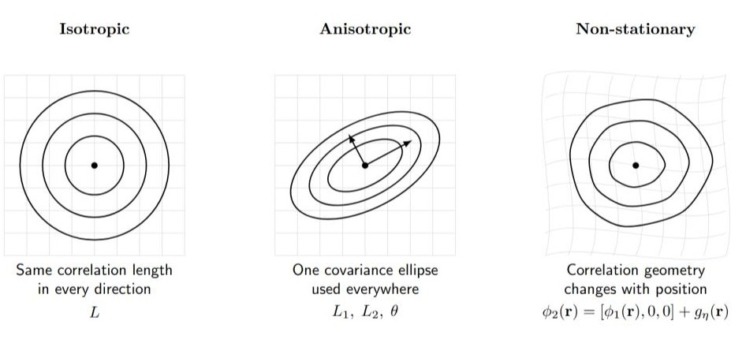
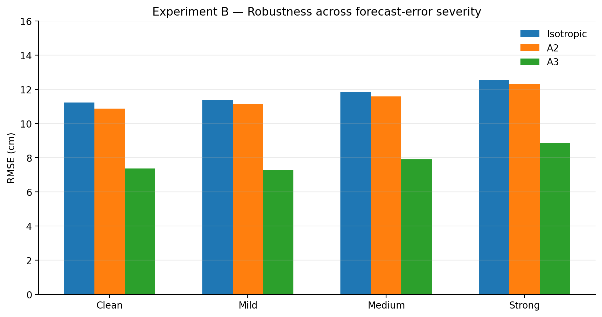

> **Disclaimer — This repository builds directly on the framework introduced by Oscar Chapron, Ronan Fablet, and Yann Stéphan in _Optimal sensor placement for the reconstruction of ocean states using differentiable Gumbel-Softmax sampling operator_ (arXiv:2604.22511), with code released in [`CIA-Oceanix/GumbleSoftmaxOptimalPlacement`](https://github.com/CIA-Oceanix/GumbleSoftmaxOptimalPlacement). The Gumbel-Softmax sensor-placement framework, Optimal Interpolation setup, isotropic covariance baseline, and experimental setting originate from their work and are not claimed here as original contributions. This repository explores covariance extensions on top of that baseline.**

# Non-stationary Ocean Sensor Placement

This repository studies covariance extensions for differentiable sensor placement in Sea Surface Height (SSH) reconstruction, and evaluates their robustness when the covariance and sensor configuration are learned from imperfect forecast ensembles.

In the baseline setting, we start from a true SSH state $\mathbf{u}$ defined on $N$ grid points. A learned Gumbel-Softmax mask selects a subset of observed locations $\mathcal{O}$:

```math
\mathbf{y}=H_{\ell}\mathbf{u}
```

A spatial covariance matrix $K\in\mathbb{R}^{N\times N}$ is defined over the **entire grid**, with one entry for every pair of locations:

```math
K_{ij}=C(\mathbf{r}_i,\mathbf{r}_j)
```

If $\mathcal{O}$ denotes the selected sensor locations, the two matrices used by Optimal Interpolation are simply subsets of this same matrix $K$:

```math
K_{oo}=K[\mathcal{O},\mathcal{O}]
```

contains the covariances between the observed locations, while

```math
K_{*o}=K[:,\mathcal{O}]
```

contains the covariances between **all grid locations** and the observed locations.

Optimal Interpolation then reconstructs the full state as

```math
\hat{\mathbf{u}}=K_{*o}\left(K_{oo}+\sigma_n^2 I\right)^{-1}\mathbf{y}
```

The reconstruction therefore depends directly on the covariance function $C$ used to build $K$.

The original baseline uses an isotropic covariance:

```math
C(\mathbf{r}_i,\mathbf{r}_j)
=\sigma_f^2\exp\left(-\frac{\|\mathbf{r}_i-\mathbf{r}_j\|_2^2}{2L^2}\right)
```

with a single learned length scale $L$.

We study two extensions of this covariance model:

- **A2 — global anisotropic covariance**
- **A3 — learned non-stationary covariance geometry**

---

## Covariance extensions

<p align="center">
  
</p>

### Isotropic baseline

The baseline uses a single spatial length scale:

```math
C(\mathbf{r}_i,\mathbf{r}_j)
=\sigma_f^2\exp\left(-\frac{\|\mathbf{r}_i-\mathbf{r}_j\|_2^2}{2L^2}\right)
```

Equal-covariance contours are circles: correlation decays identically in every direction and the same geometry is used everywhere.

### A2 — Global anisotropy

A2 introduces two directional length scales and a rotation:

```math
\phi_{\mathrm{A2}}(\mathbf{r})
=\begin{bmatrix}
(\cos\theta\,x+\sin\theta\,y)/L_1 \\
(-\sin\theta\,x+\cos\theta\,y)/L_2
\end{bmatrix}
```

The covariance becomes:

```math
C(\mathbf{r}_i,\mathbf{r}_j)
=\sigma_f^2\exp\left(-\frac{1}{2}
\left\|\phi_{\mathrm{A2}}(\mathbf{r}_i)-\phi_{\mathrm{A2}}(\mathbf{r}_j)\right\|_2^2\right)
```

Equivalently, A2 replaces the isotropic Euclidean distance with a learned **Mahalanobis distance**, allowing different correlation scales along different spatial directions. This replaces circular covariance contours with a single learned ellipse over the whole domain.

### A3 — Non-stationary geometry

A3 allows the covariance geometry to vary spatially by augmenting the A2 coordinates with a learned deformation:

```math
\phi_{\mathrm{A3}}(\mathbf{r})
=\left[\phi_{\mathrm{A2}}(\mathbf{r}),0,0\right]
+g_{\eta}(\mathbf{r}_{\mathrm{norm}})
```

with

```math
g_{\eta}:\mathbb{R}^2\rightarrow\mathbb{R}^4,
\qquad 2\rightarrow64\rightarrow64\rightarrow4
```

The covariance becomes:

```math
C(\mathbf{r}_i,\mathbf{r}_j)
=\sigma_f^2\exp\left(-\frac{1}{2}
\left\|\phi_{\mathrm{A3}}(\mathbf{r}_i)-\phi_{\mathrm{A3}}(\mathbf{r}_j)\right\|_2^2\right)
```

Unlike A2, the effective covariance geometry can vary with position.

The final layer of $g_{\eta}$ is initialized to zero, so A3 starts from the A2 solution before learning the non-stationary deformation.

---

## Results

### Experiment A — Covariance geometry on clean SSH

Experiments use 25 SSH states sampled throughout the NATL60 year, with the same 0.1% observation-budget setting and reconstruction protocol used for the baseline comparison.

| Method | RMSE (m) ↓ | EV (%) ↑ | Sensors |
|---|---:|---:|---:|
| **A3** | **0.0696** | **95.68** | 68.3 |
| A2 | 0.1099 | 89.57 | 68.4 |
| Isotropic baseline | 0.1123 | 89.11 | 68.2 |
| Random | 0.1841 | 70.76 | 78.4 |

A3 reduces RMSE by approximately **38% relative to the isotropic baseline** under this experimental setting. A2 provides only a small improvement, whereas the learned spatial deformation in A3 produces a substantially larger gain.

Results: [`data/experiment_A/paper_metrics_summary.csv`](data/experiment_A/paper_metrics_summary.csv). Code: [`src/exp A code/`](src/exp%20A%20code/).

### Experiment B — Robustness to imperfect forecast ensembles

We investigate whether the covariance improvements persist when sensor placement and covariance parameters are **learned from imperfect forecast ensembles** rather than directly from the clean SSH state.

For each of the same 25 NATL60 days, we construct **19 conditions**: one clean control and six error families (**deformation, amplitude, large-scale bias, noise, smoothing, and a combined perturbation**) at three severity levels. Each condition provides a **10-member forecast ensemble**. The methods are optimized using the corresponding ensemble, then evaluated against the **unperturbed SSH reference field**, averaging over 100 fixed-seed hard Gumbel-Softmax mask draws.

<p align="center">
  
</p>

Mean reconstruction RMSE on the clean reference field, in **centimetres**, averaged over the 25 days:

| Training ensemble | Random | Isotropic | A2 | **A3** | A3 gain vs Isotropic | A3 wins |
|---|---:|---:|---:|---:|---:|---:|
| Clean | 18.3 | 11.2 | 10.9 | **7.4** | 34.3% | 25/25 |
| All perturbed conditions | 18.3 | 11.9 | 11.7 | **8.0** | 33.3% | 448/450 |
| Mild (all six error types) | 18.3 | 11.4 | 11.1 | **7.3** | 36.0% | 150/150 |
| Medium (all six error types) | 18.3 | 11.8 | 11.6 | **7.9** | 33.7% | 149/150 |
| Strong (all six error types) | 18.3 | 12.5 | 12.3 | **8.8** | 30.4% | 149/150 |
| Strong smoothing | 18.3 | 15.5 | 15.4 | **13.3** | 14.5% | 24/25 |

*A3 gain* is the mean per-day percentage RMSE reduction relative to Isotropic, not the reduction calculated from the rounded mean RMSE values in the table.

**Main findings.** A3 outperforms Isotropic on **448/450 perturbed day–condition pairs**, with a **33.3%** mean relative RMSE reduction. A2 accounts for about **6.2%** of the Isotropic-to-A3 reduction. Thus, the learned non-stationary geometry appears to provide the principal additional benefit. **Strong smoothing** is the clearest weakness: the relative improvement drops to **14.5%**; the two cases where A3 loses both occur on the same day, under medium and strong smoothing.

**Limitations.** This is an **idealized same-day perturbation test**, not sequential operational assimilation or unseen-day generalization. The 10-member ensembles are derived from each day's reference state, and models are retrained separately for each day and condition. The clean control contains 10 identical copies, which may help explain why some perturbed training conditions outperform it. Only one model seed and one perturbation seed are used; the deformation fields are reused across days. A3 and Isotropic use similar numbers of sensors (**67.4** and **67.1** on average), but a placement/covariance swap ablation has not been performed. The Random baseline has a fixed covariance length scale, rather than a separately optimized one.

Full results and reproducibility details: [`data/experiment_B/README.md`](data/experiment_B/README.md), [`experiment_B_daily.csv`](data/experiment_B/experiment_B_daily.csv), [`experiment_B_summary.csv`](data/experiment_B/experiment_B_summary.csv), [`a2_truth.csv`](data/experiment_B/a2_truth.csv), and [`report.txt`](data/experiment_B/report.txt). Code: [`src/exp B code/`](src/exp%20B%20code/).

---

## Experimental setting

### Experiment A

For each selected day:

1. Sensor locations are represented by learnable logits.
2. Hard observation masks are sampled using the straight-through Gumbel-Softmax estimator.
3. Sparse observations are reconstructed with Optimal Interpolation.
4. Sensor placement and covariance parameters are optimized jointly.
5. Final performance is evaluated using fresh hard observation masks.

The experiment is an **idealized same-state reconstruction experiment**: optimization and evaluation use the same underlying SSH state, following the baseline experimental setting.

The purpose of this experiment is to isolate the impact of covariance geometry on reconstruction and sensor placement.

### Experiment B

For each day and error condition, Isotropic is trained on the 10-member ensemble first, A2 is warm-started from Isotropic, and A3 is warm-started from A2. The trained models are then evaluated against the clean SSH reference, using the same fixed-seed evaluation protocol. The error types are calibrated to comparable forecast-ensemble RMSE magnitudes at each severity level.

The completed run covers **475 day–condition pairs** (25 days × 19 conditions), using AMD Instinct MI210 GPUs for approximately **325 GPU-hours**. Unlike operational data assimilation, the imperfect ensemble is used to **learn placement and covariance**; it is not assimilated as a nonzero background state in the OI formula above.

---

## Data

Experiments use Sea Surface Height fields from the NATL60 Gulf Stream dataset.

The preprocessing follows the spatial domain used by the baseline experiment, with a final reconstruction grid of 280 × 280.

---

## Acknowledgment

This project would not exist without the original sensor-placement framework developed by Oscar Chapron, Ronan Fablet, and Yann Stéphan.

Please refer to their paper:

**Optimal sensor placement for the reconstruction of ocean states using differentiable Gumbel-Softmax sampling operator**  
Oscar Chapron, Ronan Fablet, Yann Stéphan  
arXiv:2604.22511

and the accompanying implementation:

[`CIA-Oceanix/GumbleSoftmaxOptimalPlacement`](https://github.com/CIA-Oceanix/GumbleSoftmaxOptimalPlacement)

for the original method, baseline experiments, and implementation.
